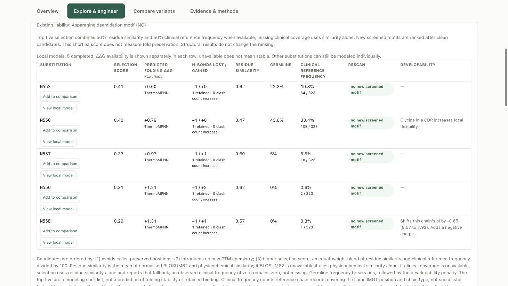

# Antibody Atlas

A free, local antibody developability workbench for academic labs and companies with limited engineering resources. Bring numbering, structure modeling, chemical liabilities, surface charge and hydrophobicity, and candidate substitution analysis into one workflow. Screen individual antibodies or batch panels, then prioritize the experiments that matter.

**[Download the preview ZIP](https://github.com/andrewskora-create/antibody-atlas/releases/download/v0.1.0-rc2/antibody-atlas-0.1.0-rc2.zip)** · **[Setup instructions](#download-and-start)** · **[Release notes and checksums](https://github.com/andrewskora-create/antibody-atlas/releases/tag/v0.1.0-rc2)**

**Built on community research.** Atlas integrates the work of the authors of ANARCII/ANARCI, ImmuneBuilder, FreeSASA, Paragraph, AntiBERTy, OpenMM/PDBFixer, ThermoMPNN, NGL, OGRDB, Thera-SAbDab and UniProt, with optional DeepSP and PROPERMAB. The underlying tools and models are their work; Atlas provides the integration, interface and labeled screening rules. [Methods, authors and original sources](MODULE_GUIDE.md#methods-authors-and-original-sources) · [Third-party notices](THIRD_PARTY_NOTICES.md). Please cite the methods you use, not just Atlas.

**Local by design.** Sequences and coordinates stay on your computer during analysis. Internet access is needed to install dependencies and download model files. No account or prediction-service subscription is required.

**Preview v0.1.0-rc2:** tested on Apple Silicon macOS with Python 3.12 and Chrome. Linux/WSL support is subject to the repository's platform checks; native Windows is not a supported complete structure workflow. This is a guided source installation, not a signed standalone desktop application.

Atlas is a starting point for ranking, prioritization and experimental focus. It does not replace a targeted or full antibody-engineering campaign, and it does not establish manufacturing readiness. Code is available under Apache-2.0 without a software license fee and without warranty. Third-party components retain their own terms.



---

## Can I use this?

**Yes.** Atlas code is Apache-2.0 licensed, with no software license fee for academic or commercial use. Retain the required license and attribution notices. It is provided without warranty; predictions require experimental validation. Third-party tools and data retain their own terms.

These optional resources are **not distributed in the source archive**:

| | Who can use it | How to get it |
|---|---|---|
| Reference corpora (clinical precedent, comparison panel) | review upstream data terms; not redistributed here | `python setup/build_reference_data.py --all` — builds locally from Oxford's CSV |
| PROPERMAB surface descriptors | **academic only**, per Regeneron's licence | `python setup/fetch_optional.py --propermab` |
| DeepSP spatial aggregation / charge prediction | everyone — it is MIT | `python setup/fetch_deepsp.py` |

If you are at a company, do not install PROPERMAB. Install DeepSP instead: it
predicts the same spatial aggregation and charge properties from sequence
alone, permits academic and commercial use with its MIT notice retained, and needs no structure. See
[USE_TIERS.md](USE_TIERS.md) for exactly what differs between the two.

Full audit in [COMPLIANCE.md](COMPLIANCE.md); dataset terms in
[DATA_PROVENANCE.md](DATA_PROVENANCE.md).
If you are forking this for your own molecules, read
[PUBLISHING.md](PUBLISHING.md) before any public push.

## Candidate workspace

After screening, the input form collapses into **Edit inputs**. **Overview** collects the screening signals and experimental evidence gaps. **Explore & engineer** puts sequence/IMGT position selection, the parent structure and substitution options together. **Compare variants** evaluates selected single or combined substitutions against the same parent and molecular charge basis. **Evidence & methods** retains reference comparisons, sources and downloads.

Use **Preview local structure** to build and identically relax parent and mutant coordinates, then inspect lost, gained and retained hydrogen bonds and close-contact counts. Use **Predict structure for each variant** in the comparison view for independent structure predictions and matched surface maps. Both viewers offer aligned side-by-side and overlay views, linked cameras and coordinate downloads. Local relaxation does not provide folding or binding free energy. Reference sequence evidence and calculated geometry are not experimental validation of a proposed variant.

Charge comparisons report the whole Fv or assembled H2L2 molecule at the selected pH, alongside both input-chain values. Constant-region sequence assembly changes the charge calculation; it does not add constant-domain coordinates to an Fv model. Missing results remain explicit.

## Download and start

**For a first installation, download the versioned ZIP from GitHub Releases, unzip it, and keep the whole folder together.** You do not need to clone a repository or use Git for routine startup. Git is still required during setup because two dependencies install from pinned upstream commits.

### macOS

1. Install [Homebrew](https://brew.sh/) if needed, then run once in Terminal:
   ```bash
   brew install python@3.12 hmmer git
   ```
   If installing a compiled dependency asks for Apple's developer tools, run `xcode-select --install`, finish that installation, then try again.
2. Download and unzip the release. Double-click **Start Antibody Atlas.command** in the extracted folder. If macOS blocks it, use the system's normal approval prompt for this downloaded script; do not disable Gatekeeper globally. A terminal alternative from the extracted folder is `bash run_local.sh`.
3. The first start creates a private `.venv`, installs dependencies and the MIT-licensed stability predictor, then opens your default browser. Chrome is supported. Leave the terminal open while using Atlas. Later starts reuse the installation.

Internet is needed for installation and first-use model downloads; scientific calculations run locally. No input sequences or coordinates are sent to a prediction service. Run the bundled public example before using your own data. This is a source release with a guided setup, **not** a signed standalone Mac application.

### Linux / Windows with WSL2

For Ubuntu 24.04, install the prerequisites, then run from the extracted folder:

```bash
sudo apt update
sudo apt install python3 python3-venv python3-dev build-essential hmmer git
bash run_local.sh
```

Fresh Linux setup selects CPU PyTorch from the official PyTorch index to avoid downloading CUDA runtimes. An existing PyTorch installation is kept. No GPU is required.

Use Python **3.11 or 3.12**. Other distributions may need different package names. Windows users should use WSL2 for the complete structure workflow; native Windows is not a supported full-workflow release. See [PLATFORMS.md](PLATFORMS.md) for the limitations and validation status.

### Add clinical reference data when needed

The core download intentionally omits the clinical reference corpus. Build it locally to enable the clinical-frequency component of substitution ranking:

```bash
.venv/bin/python run.py --setup-only --references
```

This explicitly downloads and derives data from the upstream source; its terms and provenance are described in [DATA_PROVENANCE.md](DATA_PROVENANCE.md). Until it is built, clinical frequency is unavailable and the ranking falls back to residue similarity. PROPERMAB is **never installed by the default setup**; it has separate academic-only terms. DeepSP is optional: `.venv/bin/python -m pip install h5py` followed by `.venv/bin/python setup/fetch_deepsp.py`.

### Startup and troubleshooting

- Start: `bash run_local.sh`. Stop: **Ctrl-C** in its terminal. Analyses are held in a temporary session; download results before stopping.
- If Atlas is already running on port 8000, the launcher opens that session. It does not kill it or erase its results. After a code update, stop the old server and start again.
- If another program uses the port: `PORT=8010 bash run_local.sh`.
- For a headless machine: `ATLAS_NO_BROWSER=1 bash run_local.sh`; open the printed local URL yourself.
- Check engines: `.venv/bin/python scripts/doctor.py`.
- Install without starting: `bash run_local.sh --setup-only`.
- Preload structure-model 1 weights: `.venv/bin/python run.py --setup-only --warmup`. Other engines/models can still need their own first-use downloads.
- An incompatible or incomplete `.venv` is left untouched. Rename it and restart with Python 3.11 or 3.12 to build a new environment.

The server binds to **127.0.0.1 only**. It has no authentication and is intended for one local user; do not expose it on a network. Setup is skipped when the requirements hash matches the completed installation. A failed download can be retried; it does not require deleting your project.

Dependency versions use compatibility ranges and selected pinned commits, not a complete lockfile; a future installation may resolve newer packages. For development, install `requirements-dev.txt`, then run `python -m pytest tests/ -q`. CI runs the Python suite on Linux with Python 3.11 and 3.12, browser logic checks, and startup checks on macOS and Linux. The release builder produces checked ZIP/tar downloads with SHA-256 checksums; [PUBLISHING.md](PUBLISHING.md) describes the release process.

## What it does

**Shared residue coordinates.** Numbering, sequence motifs, germline comparison,
exposure and predicted contacts are joined onto a common IMGT residue frame,
with Kabat numbering alongside when selected. The interface separates chemical
liabilities, predicted binding-surface residues without liabilities, and the full
residue table. Chemical calls use `evaluate`, `watch` or `clear`; `preserve`
identifies predicted contacts without chemical liabilities. Contact evidence
remains separate so it cannot hide a chemical concern. Each row records the
layers available, and missing evidence remains explicit.

**Liability screen.** Deamidation, isomerization, glycosylation sequons,
Asp-Pro cleavage, oxidation-susceptible residues, noncanonical cysteines and
N-terminal pyroglutamate, located in IMGT or Kabat and split by CDR and
framework.

**Structure.** ABodyBuilder2 predicts the Fv; FreeSASA gives per-residue
relative side-chain exposure, so a buried motif is distinguished from an
exposed one. Charged and hydrophobic surface patches come from a contact-graph
screen over exposed side chains.

Optionally three models rather than one. A single predicted structure is one
hypothesis with no error bar, and exposure is exactly where that bites: a loop
one model places facing out and another tucks in flips a PTM site's priority,
and you see a confident answer either way. With the ensemble, exposure is the
**maximum** across models — a site exposed in any model is treated as exposed,
which is ABodyBuilder2's own recommendation and TAP2's convention — and every
residue where the models disagree is reported as weak evidence rather than
quietly taking the high number. Coordinates are never averaged. It costs one
fold per model, so the default stays at one.

**Sequence-only spatial descriptors.** DeepSP predicts spatial aggregation
propensity and positive and negative spatial charge maps over each CDR and the
whole Fv, from the paired sequence alone in milliseconds. It is MIT, so unlike
the PROPERMAB descriptors it is available to commercial users, and because it
needs no structure it runs on every molecule in a batch. It predicts what a
molecular-dynamics simulation would have reported, not what an experiment
measured.

**Model the top five substitutions.** The position explorer ranks all 19 alternatives, then automatically builds and locally relaxes the first five. The shortlist score is an equal-weight blend of residue similarity (BLOSUM62 plus physicochemical similarity) and clinical reference frequency at the same IMGT position. Preserved positions and newly introduced screened liabilities retain precedence; missing clinical evidence is labeled as similarity-only. This is a selection heuristic, not a calibrated probability of success. Other candidates can still be modeled on demand. Results include hydrogen bonds lost/gained/retained, clashes and downloadable parent/variant coordinates.

**Predicted folding stability.** ThermoMPNN estimates single-substitution folding ΔΔG from the parent chain's backbone coordinates and sequence. Install its pinned MIT-licensed source and checkpoints locally with `python scripts/setup_stability.py`. Inference uses the existing CPU PyTorch installation; it sends no sequences or structures to a service. Negative values indicate predicted stabilization and positive values destabilization, in kcal/mol. This learned prediction is separate from OpenMM local relaxation and is not an alchemical free-energy calculation, antigen-binding ΔΔG, or experimental result. It assesses the selected chain rather than the full antibody/antigen complex. Cysteine substitutions, antibody-specific effects and extrapolation outside the training distribution require caution; no universal pass threshold or confidence interval is implied. Missing weights or incomplete backbone coverage produce an explicit unavailable result. Predicted ΔΔG does not silently reorder the initial shortlist.

**PTM-fix engineering.** For each liability, candidate substitutions are rescanned to identify removal of the motif and newly introduced screened motifs. The mixed shortlist score, clinical/germline frequencies and structural consequences remain separately inspectable. See [PTM_FIX_ENGINEERING.md](PTM_FIX_ENGINEERING.md).

**Paratope awareness.** Paragraph predicts which positions contact antigen.
Predicted contacts are preserved automatically, so fixes that avoid the binding
surface rank ahead of fixes that do not — and when the only fix is on a
contact, you are told rather than it being promoted quietly.

**Molecule-level properties, on a full-length basis.** pI, net charge, CDR
hydrophobicity, inter-chain charge asymmetry and hydrophobic windows, each
mapped only to the outcomes it is supported for: colloidal stability,
non-specific binding, clearance and viscosity. Trade-offs are reported rather
than collapsed into a score, because raising net charge helps viscosity and
works against clearance at the same time. Attach a wild-type secreted constant
region (IgG1-4, kappa or lambda, from UniProt) and these are computed on the
assembled H2L2, which is the basis the published charge-and-clearance analyses
used — a variable-domain pI rank-orders candidates but is not the quantity
those papers thresholded on. Immunogenicity is deliberately absent: charge and
hydrophobicity reach it only through aggregation, and a pI value is not an
immunogenicity signal.

**Comparison.** AntiBERTy likelihoods, human V-gene framework identity, and a
protocol-matched therapeutic reference panel: every approved human or
humanised paired whole mAb in the Thera-SAbDab snapshot, scored locally under
one protocol, rather than a curated selection. Descriptors carry both the
observed range and a percentile position within it, because "inside the range"
cannot tell a molecule sitting with the bulk from one pressed against the wall.
Neither is an acceptance interval: a percentile says where a molecule sits
among approved antibodies, not whether that position is acceptable.

## Headless use

```bash
python run_panel.py --panel panel.json --out results/ --fold --substitutions
```

Runs a parent and its variants unattended and writes JSON, CSV and a PDF
summary. `--check` reports which engines are available before committing to a
long run. See [LINUX_AND_HEADLESS.md](LINUX_AND_HEADLESS.md).

## What it will not tell you

Every priority is a screening heuristic for ordering experiments. None is a
probability of aggregation, clearance, immunogenicity or viscosity. A sequence
motif is a pattern, not an observed modification: confirm by peptide mapping or
forced degradation before engineering anything away. Substitution rankings do
not predict retained binding, potency, expression or thermostability, and every
candidate needs testing. Reference panels here were not selected for favourable
experimental behaviour, so being within range means similar on that descriptor
and nothing more.

## Citing the methods

This project is a harness around other people's work. If you publish results
from it, cite the methods you actually used — ANARCI/ANARCII, ImmuneBuilder,
FreeSASA, AntiBERTy, Paragraph, Thera-SAbDab, OGRDB and PROPERMAB where
applicable. [MODULE_GUIDE.md](MODULE_GUIDE.md) lists them per module, and
Thera-SAbDab specifically asks for Raybould, Marks et al., *Nucleic Acids Res.*
(2019) gkz827.

## Licence

See [LICENSE](LICENSE) and [NOTICE](NOTICE). Third-party notices are in
[THIRD_PARTY_NOTICES.md](THIRD_PARTY_NOTICES.md).
